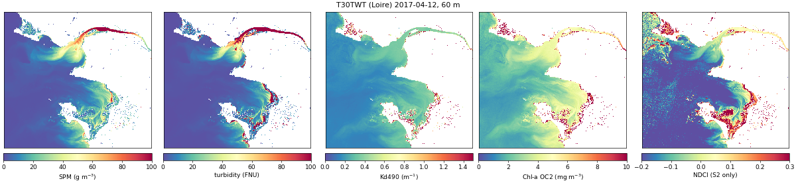
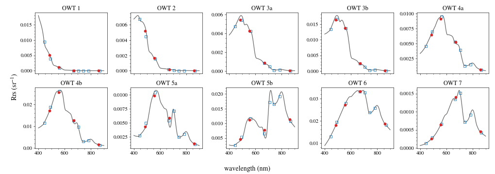
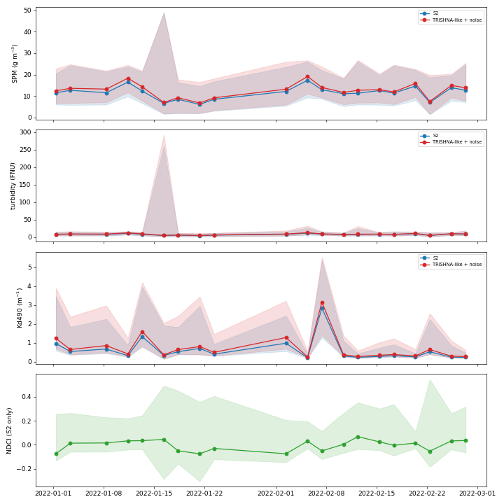
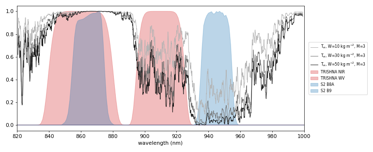
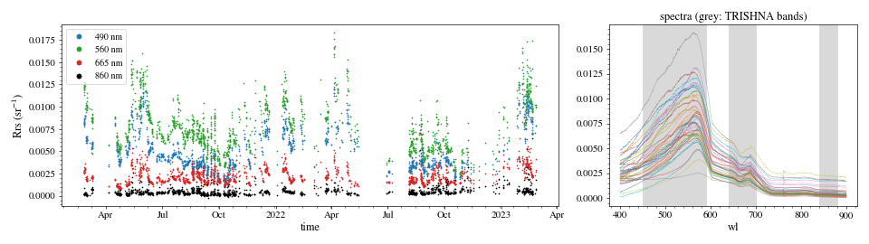

.. _assessment:

Pre-launch assessment
=====================

What can TRISHNA monitor over water compared with Sentinel-2? This page summarizes the results of
the scripts and of the tutorials (state of November 2026). The methods are in :doc:`methods`.

.. admonition:: In short
   :class: tip

   - **Retrievable with TRISHNA:** SPM and turbidity (red, NIR), diffuse attenuation
     (:math:`K_d(490)`, :math:`K_d(\mathrm{PAR})`), about 7 optical water types, and blue/green
     Chl-a in clear waters only.
   - **Lost:** red-edge Chl-a (productive and eutrophic waters), CDOM, the QAA inherent optical
     properties and the Secchi depth as implemented (443 nm).
   - **Atmospheric correction:** with the aerosol and sunglint from 865/1610 nm, GRS over-corrects
     in moderately turbid waters (bias about −0.002 sr\ :sup:`-1`): the NIR water signal has to be
     handled.
   - **Water vapour:** the 910 nm band does not saturate but is 3-4 times less sensitive than 945 nm.

Algorithm coverage
------------------

With a tolerance of 15 nm on the wavelengths (``algorithms.coverage``):

.. list-table::
   :header-rows: 1
   :widths: 30 70

   * -
     - Algorithms
   * - Run on TRISHNA
     - OC2-type blue/green Chl-a (clear to moderate waters), Nechad SPM (665 nm), Dogliotti turbidity
       (665/865 nm), red/NIR SPM index, KD2 :math:`K_d(490)`, Roy and Das :math:`K_d(\mathrm{PAR})`,
       NDI of Bi et al. (2024); a QAA variant with 485 nm in place of 443 nm, to develop
   * - Lost
     - red edge: NDCI, Gons, Gilerson, Moses 2009, Binding 740, Brezonik CDOM; 443 nm: OC3, QAA v6,
       Jiang SPM switching; the OWT-blended Chl-a and SPM of GRSl2bgen

The main consequence is that **Chl-a in productive and eutrophic inland waters (red-edge algorithms)
cannot be retrieved**, and CDOM loses its standard algorithms.

   Products of a GRS L2A image of the Loire estuary and plume (T30TWT, 2017-04-12, 60 m) available
   with the TRISHNA-like bands, and the red-edge NDCI, S2 only (tutorial *Which water quality products
   survive with TRISHNA bands?*). On this image, the band adjustment changes the products by 2-4 %, the
   requirement noise by 5-13 % (35 % for the red/NIR index).

Optical water types
-------------------

Percentage of the synthetic members of the 10 Bi et al. (2024) types classified as their hyperspectral
spectrum:

.. list-table::
   :header-rows: 1
   :widths: 50 25 25

   * - Band set
     - noise-free
     - with requirement noise
   * - S2 (8 water bands)
     - 95 %
     - 89 %
   * - S2 restricted to the TRISHNA bands
     - 85 %
     - 78 %
   * - TRISHNA responses (485/555/670/860 nm)
     - 89 %
     - 78 %
   * - TRISHNA without 860 nm
     - 78 %
     - --

- The sub-types 3a/3b (2.0°), 4a/4b (3.2°) and 1/2 (5.4°) are nearly collinear on the TRISHNA
  bands: **about 7 types are separable, not 10** (``owt.TRISHNA_MERGE``).
- The 860 nm band matters (+11 points). The default ``wl_range=slice(350, 800)`` of GRSl2bgen drops it.
- On a GRS L2A image of Lake Chad (25,700 water pixels at 60 m), S2 restricted to the TRISHNA bands
  agrees with all the S2 bands on 82 % of the pixels; most disagreements are type 6 classified as 5b.
- On the HYPERNETS spectra of the Berre lagoon, the TRISHNA bands give the hyperspectral type in
  93 % of the cases (S2: 94 %): the synthetic benchmark is pessimistic.

   Optical water types with the TRISHNA bands (tutorial *Optical water types with TRISHNA bands*).

Band adjustment from Sentinel-2
-------------------------------

- Green, Red and NIR need on average a correction of 2 to 6 %.
- **Blue needs ×1.28 (clear) to ×0.84 (turbid)**, Red up to ×1.17 in very turbid waters (type 5b): the
  factors depend on the water type. Emulating TRISHNA by dropping S2 bands is biased;
  ``emulate.owt_band_adjustment`` applies factors by type.
- The effect depends on the water type: 2-4 % on the products of the Loire plume (mostly
  moderately turbid), more in very turbid waters. On Lake Chad (20 dates), with the S2 coefficients of the algorithms, the adjustment raises
  SPM/turbidity by 7-16 % and :math:`K_d(490)` by 20-40 %: the algorithms have to be re-tuned for
  TRISHNA before merging S2 and TRISHNA time series.
- In situ (HYPERNETS, Berre lagoon), the TRISHNA/S2 ratios are 0.92 (Blue), 0.94 (Green), 1.00 (Red)
  and 1.01 (NIR): the type-based model reproduces Blue and Red within 1 %, Green and NIR within 3-5 %.

   Time series of SPM, turbidity, :math:`K_d` and OWT, S2 and TRISHNA-like (tutorial *Time series of
   TRISHNA-like water products*).

Water vapour
------------

Ratio method, air mass 3:

- 910 nm is less absorbed than 945 nm. Its ratio remains usable in humid air (0.37 against 0.03 at
  :math:`W = 60` kg m\ :sup:`-2`), which supports the choice of the mission.
- Per unit of :math:`W`, it is 3-4 times less sensitive. With the requirement SNRs (WV: 50 at Lmin = 30;
  S2 B9: 114 at 9 W m\ :sup:`-2` sr\ :sup:`-1` µm\ :sup:`-1`), the TCWV error due to the noise is 2-4 times
  larger for TRISHNA (land, :math:`\rho = 0.3`: 0.5-3.5 against 0.1-1.6 kg m\ :sup:`-2`).
- Over water (:math:`\rho < 0.01`) neither sensor retrieves :math:`W` from the surface signal: use land
  pixels and interpolation, or the coupled path-length model of hgrs.
- The results depend on the in-flight SNR of the WV band.

   Water vapour, TRISHNA 860/910 nm vs Sentinel-2 865/945 nm (tutorial *Water vapour with TRISHNA*).

Semi-analytical inversion
-------------------------

invRrs ``MultispectralSimple`` (Chl-a, :math:`a_{CDOM}`, SPM, offset):

- With 4 bands and 4 unknowns, TRISHNA is only just determined; the correlation of Chl-a and
  :math:`a_{CDOM}` is −0.8 to −0.99.
- The relative standard deviation of Chl-a is 2 to 16 (not retrievable), against 0.7 to 9 for S2.
- SPM remains retrievable (about 20 %) in low and moderate turbidity.
- Chl-a needs constraints: OWT priors, regional CDOM relationships, the temperature of the thermal
  bands, or the time series.

Validation with HYPERNETS
-------------------------

Berre lagoon (BEFR), 2021-2023: 80 S2 acquisitions within 1 h of a HYPERNETS record, 64 kept after
screening. GRS was run at 60 m with the TRISHNA-like and with all the S2 bands (same version and
settings); the archived standard GRS products (20 m) are a reference of the processing.

.. list-table:: Rrs at the site: median bias (sr\ :sup:`-1`) / MdAPD
   :header-rows: 1
   :widths: 16 28 28 28

   * - Band
     - GRS, TRISHNA bands
     - GRS, all S2 bands
     - Archived GRS (20 m)
   * - 490 nm
     - −0.0020 / 43 %
     - −0.0008 / 30 %
     - −0.0002 / 15 %
   * - 560 nm
     - −0.0024 / 35 %
     - −0.0011 / 23 %
     - −0.0007 / 15 %
   * - 665 nm
     - −0.0016 / 62 %
     - −0.0005 / 39 %
     - −0.0001 / 22 %

- The TRISHNA band set over-corrects. The matchups where the 865/1610 nm pair retrieves a higher AOT
  than the SWIR pair have the most negative errors: in these moderately turbid waters the 865 nm water
  signal is not zero and is partly taken as aerosol. A TRISHNA processing needs a NIR water-signal
  correction (similarity spectrum, iterative scheme) or a larger weight on 1610 nm.
- SPM and turbidity inherit the bias (MdAPD 63 % with the TRISHNA bands, 41 % with the S2 bands, 23 %
  archive); :math:`K_d(\mathrm{PAR})` is robust (about 7 %).
- The 60 m re-processing is about twice worse than the archived products for both band sets: the
  TRISHNA vs S2 comparison is fair, the absolute errors are pessimistic.
- 865 nm is not validated (no skill for any band set), and 910 nm is out of the HYPERNETS range.

   HYPERNETS matchups, Berre lagoon (tutorial *Validation with HYPERNETS: Sentinel-2 vs TRISHNA bands*).

Caveats
-------

- The OWT members are synthetic (mean ± shape perturbations of the standard deviation): to be replaced
  by in situ spectra or the Bi et al. (2024) training set.
- The TRISHNA spectral responses are modelled.
- The noise is white, at requirement level, and the two sensors specify their SNR at different radiances.
- The coefficients of the algorithms have not been re-tuned for the TRISHNA bands.
- One validation site.
