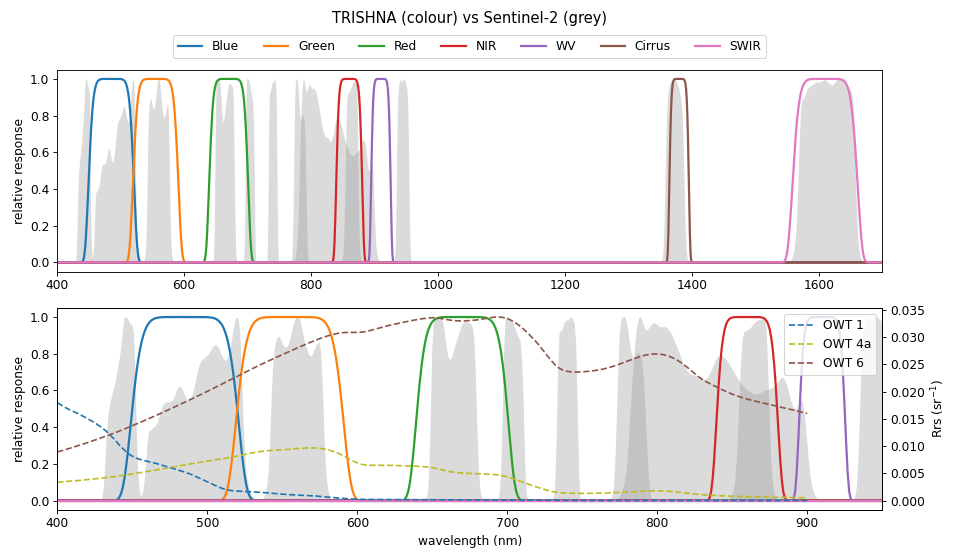

trishna_tbx documentation
=========================

``trishna_tbx`` assesses, before the launch of the satellite, what the visible to short-wave
infrared (VSWIR) bands of **TRISHNA** can monitor over inland and coastal waters compared with
**Sentinel-2**: water-quality parameters, optical water types (OWT) and atmospheric water vapour.

TRISHNA (Thermal infraRed Imaging Satellite for High-resolution Natural resource Assessment,
CNES/ISRO) is a thermal infrared mission, planned for launch in 2028, that also carries 7 VSWIR
bands at 60 m. Over water, it keeps only 4 bands in the visible and near infrared (485, 555, 670
and 860 nm) plus a water vapour band at 910 nm, a cirrus band and one SWIR band at 1610 nm.
It has no band at 443 nm, none in the red edge and none at 2190 nm.

Until the first data, TRISHNA-like images are emulated from Sentinel-2 by keeping only the bands
that TRISHNA covers, and TRISHNA top-of-atmosphere signals are simulated from in situ spectra with
`radcalnet_oc <https://radcalnet-oc.readthedocs.io>`__. The same processing chains
(`GRSdriver <https://github.com/Tristanovsk/GRSdriver>`__, `grs <https://grs.readthedocs.io>`__,
`GRSl2bgen <https://github.com/Tristanovsk/GRSl2bgen>`__,
`invRrs <https://github.com/Tristanovsk/invRrs>`__) then run on both band sets.

   Spectral responses of TRISHNA VSWIR (modelled, super-Gaussian) and of Sentinel-2 MSI.

.. list-table:: TRISHNA VSWIR bands and their Sentinel-2 proxies
   :header-rows: 1
   :widths: 14 22 14 14 22 44

   * - TRISHNA
     - centre / FWHM (nm)
     - SNR at Lmin
     - S2 proxy
     - S2 centre / FWHM (nm)
     - note
   * - Blue
     - 485 / 70
     - 50
     - B2
     - 490 / 66
     - TRISHNA is about 11 nm bluer (B2 centroid 496.5 nm)
   * - Green
     - 555 / 70
     - 100
     - B3
     - 560 / 36
     - 2 times wider
   * - Red
     - 670 / 60
     - 100
     - B4
     - 665 / 31
     - 2 times wider
   * - NIR
     - 860 / 40
     - 100
     - B8A
     - 865 / 21
     -
   * - WV
     - 910 / 30
     - 50
     - (B9)
     - 945 / 20
     - no S2 equivalent: different absorption depth
   * - Cirrus
     - 1380 / 30
     - 25
     - B10
     - 1375 / 31
     -
   * - SWIR
     - 1610 / 100
     - 100
     - B11
     - 1610 / 91
     - aerosol and sunglint (no 2190 nm)

The package is developed for the CNES study *Support aux développements d'un produit TRISHNA
qualité des eaux* (MAG-25-PT-121). Its tutorials are the TRISHNA notebooks of the
`Water Quality VRE gallery <https://ocean-and-coastal-water-quality-vre.netlify.app/>`__.

.. code-block:: python

   from trishna_tbx import TRISHNA, make_s2, algorithms

   print(algorithms.coverage([make_s2(), TRISHNA]))   # which algorithms each sensor can run

.. toctree::
   :maxdepth: 2
   :caption: User guide

   installation
   usage
   methods
   assessment
   processing_chain

.. toctree::
   :maxdepth: 2
   :caption: Tutorials

   tutorials

.. toctree::
   :maxdepth: 2
   :caption: Reference

   api
   roadmap
   history

.. toctree::
   :maxdepth: 1
   :caption: Funding

   support

Indices and tables
------------------

* :ref:`genindex`
* :ref:`modindex`
* :ref:`search`
